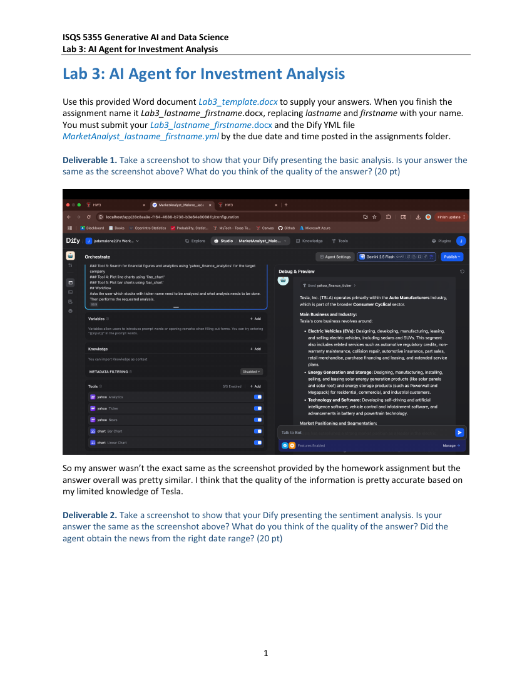

# AI Agent for Investment Analysis (Generative AI Lab)

**Dify (LLM agent workflow) · prompt engineering · market data and news tools** · Texas Tech University · ISQS 5355 Generative AI and Data Science · Lab 3

## Overview
I built an AI "market analyst" agent in Dify that researches a public company (Tesla in this lab) and produces a one-page analyst report. The agent combines three views of the company:
- **Fundamentals:** a company profile and basic analysis.
- **Technical performance:** a chart of the last 12 months of stock performance.
- **Market sentiment:** news from the last week, with sources cited.

The full lab write-up with screenshots of each step is in [`reports/Lab3_AI_Agent_Investment_Analysis.pdf`](reports/Lab3_AI_Agent_Investment_Analysis.pdf).



## What I did
1. Built the agent and ran a **basic company analysis**, then judged its quality against a reference answer.
2. Added **sentiment analysis** on recent news and checked that the agent pulled news from the right date range (it cited its sources, which confirmed the dates).
3. Had the agent **plot financial performance** and checked whether the chart really covered the requested 12-month window.
4. Generated the final **analyst report**, limited to about one page.
5. Ran further experiments on model choice and prompt structure.

## What I learned
- An agent becomes much more reliable with a **clear workflow and strict output rules**.
- Combining fundamentals, a 12-month trend chart and last-week news sentiment made the report more complete and realistic, closer to what a human analyst would deliver.
- **Controlling length takes explicit constraints:** a word limit, required headings and bullet formatting.
- **Model choice affects depth and verbosity:** more advanced models write richer analysis but need stronger output constraints.
- **Prompt structure is critical:** clear formatting rules and required sections make reports far more consistent.

## Files
```
reports/   lab write-up (PDF) with screenshots and answers
images/    page previews of the write-up
```
The exported Dify workflow file (.yml) wasn't included in the files shared for this repo.

## Skills demonstrated
Generative AI · building LLM agents with tools · prompt engineering · evaluating AI output quality · financial and sentiment analysis

---
**Jada Malone** · Data Analyst · M.S. Data Science, Texas Tech University · [GitHub profile](https://github.com/jada-malone) · [LinkedIn](https://www.linkedin.com/in/jada-malone-509170280)
